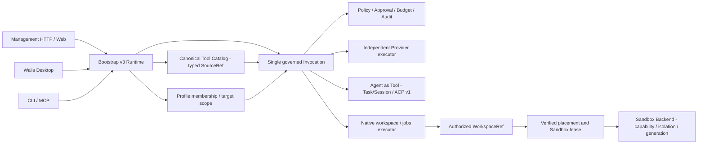

# Mender system context — v3 runtime

Mender is a tool/resource aggregation, governance and supply platform for external LLMs and agents. It does **not** own the caller's Agent Loop. A configured Agent is an **Agent as Tool** resource with its own Task/Session lifecycle.

This document describes the only supported runtime schema and execution boundary after the tool ownership hard cut (ADR-0064). Historical Provider-owned resource facades and Provider-keyed Workspace Tool targets are not part of the supported architecture.

## Source, context and execution boundaries

**Tool** identifies a callable operation and schema. Its `SourceRef` is `provider:<id>`, `agent:<id>`, or a host-reviewed `native:<key>`. **Provider** is only the independently configured external tool origin, not a mandatory parent of Agent/Native tools. **Profile** chooses which tools can be supplied and may further restrict approved target scope; selecting a tool does not grant an execution target. **Workspace** identifies the approved work object; **Sandbox** owns capability, isolation, target root, run generation, grants and lease. Native workspace operations require an exact admitted and revalidated target. External provider tools use their Provider executor; Agent-as-Tool calls use their Agent Backend and Task service.

No runtime may create a Provider facade for an Agent/Sandbox or infer that selecting a Workspace places an ACP child process inside a Sandbox. Ambiguous target selection, unsupported capability, revoked authorization and uncertain effects fail closed; there is no implicit Host fallback or unknown Task replay.

## Client and domain boundaries

- Web and desktop share `ManagementClient`; Wails exports native owner capabilities. CRUD for Agent, Sandbox, Profile, Credentials and Provider belongs to their own application boundary.
- Catalog discovery and Profile tool selection are source-first; internal `SourceRef` identities are not extra source resources a user must create.
- There is only one externally usable Invocation pathway for MCP, CLI and management actions. It owns admission, result guards and terminal audit. Provider activation and Agent Task admission retain their respective resource-specific checks.
- The v3 startup path opens only a complete typed database; legacy v2 files cannot be opened, silently converted, repaired or mixed with v3. New installations use the pinned empty v3 schema image. See [ADR-0064](adr/0064-tool-provenance-and-execution-placement-hardcut.md) and [hard-cut acceptance](../governance/runtime-v3-hardcut.md).

## Repository entry points

- `backend/internal/bootstrap/runtime.go`: official single v3 Runtime assembly.
- `backend/internal/catalog`: typed Tool source identity, discoverable canonical catalog and FTS.
- `backend/internal/invocation`: admission, Policy/Approval/Budget, execution dispatch and audit.
- `backend/internal/workspace`: logical WorkspaceRef, placement filtering and governed native operations.
- `backend/internal/sandbox`: runtime backend, verified capability/isolation, grants and lease.
- `backend/internal/agent`: Agent as Tool, ACP v1 Task/Session and native approval.
- `packages/app/src`: shared React product UI; `packages/sdk/src`: HTTP client; `apps/desktop/frontend`: Wails client.
