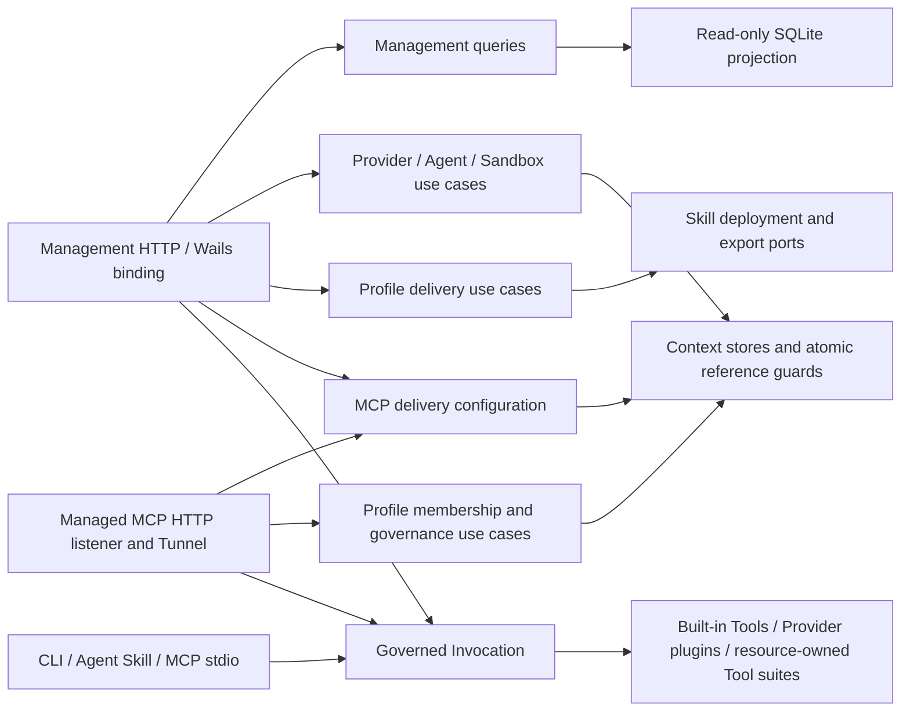
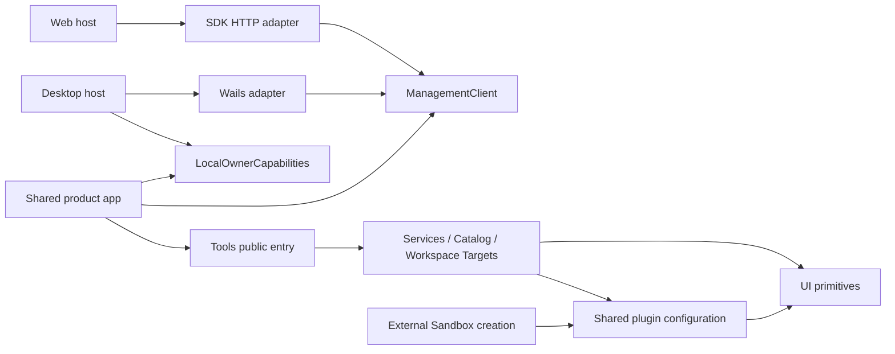

# System Context

This document diagrams the **currently implemented** Provider-backed Tool facades and Workspace/Sandbox bridging. The accepted **future** hard-cut ownership contract is [ADR-0064](adr/0064-tool-provenance-and-execution-placement-hardcut.md), with [Phase A inventory](../planning/tool-hardcut-phase-a-inventory-2026-11-07.md). The [Stage C guarded placement adapter](../planning/tool-hardcut-stage-c-2026-11-07.md) is tested but **not constructed by the current production Runtime**, because the new Catalog SourceRef and Profile TargetScope persistence are not yet activated. Do not read this diagram as evidence that the new typed SourceRef or shared Workspace identities are already running.

## Backend boundaries

Solid arrows show calls across boundaries. `bootstrap.Runtime` constructs the
adapters and owns shutdown. HTTP and Wails share the management read models and
delegate writes to the application that owns the resource.

The shared Invocation entry point owns preflight, admission, execution and
terminal audit. Provider activation has its own admission decision. Agent
resource admission, ACP native permission handling and Tool authorization are
separate. Agent Task/Session execution and native approvals share one runtime
coordinator, and the local workspace verifier supplies filesystem observations.
Secrets are resolved at the execution or connection boundary.

Workspace Tool JSON decoding and Outcome mapping live in the Tool adapter.
`workspace/application` applies common operation semantics and consumes a
lease port. `workspace/infrastructure/sandboxbridge` implements that port by
calling the Sandbox router for an admitted target. Sandbox owns grants,
placement, generation, leases and driver selection. Local, Docker, Daytona,
SSH and External sessions use `workspace/domain` operation types. The
External adapter maps them to Sandbox Plugin Protocol v1.

## Client and feature boundaries

Desktop supplies approval and Agent Tool placement capability objects.
Their availability controls the UI. The backend binding still authorizes each
owner operation. The Web host supplies the common client. Feature consumers
import Tools through its public entry, and shared form controls depend on no
feature. See [local development](../development/getting-started.md) for the
repository paths and verification commands.

## Core domain language

### Provider

A source of one or more tools.

Examples include a remote MCP server, a local MCP stdio process, a built-in Go provider, or a package/bundle adapted into a supported provider form.

Provider identity is stable and must not rely solely on upstream display names.

### Tool

A canonical executable capability known to Mender.

A Tool has stable identity, human/model-facing metadata, input and output schemas, provenance, and execution requirements.

A Tool is not an MCP-specific struct.

### Profile

A named selection of canonical Tools and exact Skill installations with
restrictive execution constraints.

A Profile owns ToolBindings and its selection revision. MCP delivery owns
mode, Tunnel association, direct projection selection and a separate revision.
Profile-scoped authorization remains based on membership and binding governance.

Profiles support CLI recipes, MCP endpoints, Skill deployment and Agent Plugin
export. Local recipes and exported artifacts are explicit snapshots.

### ToolBinding

The Profile-owned relationship between one Profile and one canonical Tool.

ToolBinding may customize Profile-facing alias/title/description and may tighten execution policy or serialize calls for that binding. ToolID remains canonical identity; schemas and provenance remain Catalog-owned.

### Principal

A bounded security subject asserted by a trusted Mender adapter or composition root.

Live Principals are explicit and non-anonymous. Initial kinds distinguish the local Runtime owner from Mender-owned service identities such as a downstream Profile MCP endpoint. A Principal is not arbitrary caller text and must not be inferred from unverified transport metadata.

### Governance Context

The shared security context for governed actions. It contains Origin, Principal, and an explicit Catalog/Profile scope. Invocation and Provider activation consume the same vocabulary so Policy can reason about what authority is acquiring or using a capability.

### Invocation

A governed tool.invoke action within one Governance Context.

Invocation owns Profile membership enforcement for Profile-scoped calls, validates input before Policy/execution, derives reviewed Governance Facts, applies ToolBinding tightening and execution/result guards, and returns a canonical outcome.

An invocation may complete immediately, require additional input, be rejected, fail, be cancelled, or become a long-running task.

### Provider Activation

A governed provider.activate action that admits Provider capability acquisition before Plugin.Open, native process start, discovery Credential resolution, upstream discovery/list calls, or executor-route registration.

Provider activation is not modeled as a synthetic Tool invocation because Tool identity and arguments may not exist yet.

### Runtime Budget

The persistent Runtime-owned hard limits applied after governance admission and before execution side effects. Runtime Budget caps Tool/Principal/Provider/global concurrency, Provider activation concurrency, effective execution timeout, arguments, and results. Profile constraints may tighten these limits but cannot raise them.

### Execution Environment

The host-owned boundary used when Mender launches local child processes. Local process capabilities explicitly choose host or restricted_host isolation. restricted_host is platform-enforced containment and fails closed when unavailable; it is not presented as VM/container isolation.

### Policy

A persistent Runtime-wide PolicySet that determines whether governed actions may proceed.

Rules explicitly select actions and may match bounded Origin, Principal, scope, Provider/Tool identity, and reviewed Governance Facts where the action supports them. Matching deny decisions dominate require-approval/allow rules; the default decision applies only when no rule matches. ToolBinding policy remains a second tightening layer for tool.invoke only. Raw arguments, secrets, and Credential References do not cross the Policy boundary.

### Credential

A human-manageable Reference plus non-secret metadata for authentication material required by a Provider or Tool.

Credential inventory metadata may be persisted and selected by Profile/Provider configuration. Secret values remain infrastructure concerns and are resolved only from native OS credential storage or environment-backed sources at execution/connection boundaries.

### Audit Record

Data-minimized durable governance evidence. Invocation Audit records Principal, scope/origin, outcome classification, and relevant Policy decisions. Provider activation has a separate audit record with Principal, Provider, Policy/Approval outcome, and bounded failure metadata. Neither surface stores raw Tool payloads, Provider configs, or secret material.

## Adapter boundaries

### MCP inbound adapter

Converts MCP requests into application commands and queries.

It exposes a configured Profile using its MCP delivery mode. Managed HTTP
refreshes projections using Profile, MCP delivery and Catalog revisions. A
stdio instance uses a startup snapshot for the life of the client process.

### MCP provider adapter

Connects to upstream MCP servers, maps their tools into the canonical Catalog model, and delegates execution through the Invocation application layer. Remote non-loopback HTTP transport requires TLS; local stdio processes run without a shell and receive a reduced ambient environment. External Provider process launch additionally uses the Runtime Execution Environment when restricted_host is selected. These controls reduce authority but do not claim VM/container isolation.

### CLI adapter

Provides local search, describe, invoke, provider, profile, and server operations.

The CLI is a first-class interface, not a wrapper around HTTP.

### Agent Skill adapter

Provides progressive-disclosure instructions and optional generated resources that guide agents to use the Mender CLI/runtime.

### Management HTTP API

Provides the loopback administration transport used by the browser host. It is distinct from MCP protocol endpoints.

### Desktop binding adapter

Adapts the same Runtime/Application management semantics to Wails bindings without routing through the management HTTP server. Wails SDK imports and WebView lifecycle remain in the desktop shell; the backend adapter itself is Wails-independent.

## Persistence

The initial local implementation is expected to use SQLite.

Persistence is accessed through context-specific ports. Database schema layout must not become the domain boundary.

A later remote deployment may use a different backing store without changing domain semantics.

## Composition

Dependency construction occurs at explicit composition roots used by the `mender` CLI, `menderd` daemon/server, and Wails desktop shell.

The same application use cases are reused by all entry points.
